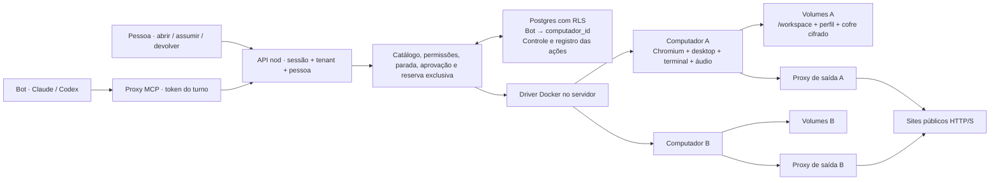

# ADR-037 — Um computador persistente por bot

Definido em 2026-09-18. O produto começa com um ambiente completo por bot, com navegador com interface, desktop Linux, arquivos, terminal e áudio. A pessoa pode assumir a mesma tela para entrar nas contas e devolver o controle. Fechar a janela não desliga o ambiente.

## Referências e escolha

| Opção | O que aproveitamos | Decisão |
|---|---|---|
| Outros assistentes | Computador persistente, takeover para autenticação, conectores e navegador complementares | Referência da experiência. Há quem compartilhe o computador da pessoa entre bots; nosso primeiro recorte é um computador por bot. |
| [OpenBot, CopilotKit](https://github.com/CopilotKit/openbot) | Volumes persistentes por bot, supervisor de computadores, separação do ambiente e autorização das ações | Referência de implantação. Integramos ao plano de turno, proxy, RLS e decisões que o nod já possui. |
| [OpenMausBot](https://github.com/milind-soni/OpenMausBot) | Harnesses separados do computador remoto | Mantemos o driver de computador substituível; não acoplamos identidade do bot ao fornecedor ou ao CLI. |
| Apenas navegador remoto | Provisionamento menor, sessões web persistentes | Insuficiente para terminal, aplicativos Linux, arquivos locais e controle do desktop. |
| Desktop e navegador compartilhados desde o início | Evita repetir login entre bots | Adiado: exige arbitragem e permissões para os recursos compartilhados. |

O `DriverComputador` permite substituir Docker por um provedor de máquinas remotas sem mudar as ferramentas e a interface. Nesta entrega o computador roda no host Docker do servidor nod. Isso é uma base implantável em servidor; não provisiona uma conta de nuvem automaticamente.

## Arquitetura

`computadores.id` é independente de `agentes.id`. O vínculo fica em `agentes.computador_id`, com unicidade para o primeiro recorte. Compartilhar computador no futuro exige mudar essa unicidade, adicionar associação/permissões e preservar um controlador por vez. Compartilhar apenas navegador exige um recurso independente e um protocolo para arquivos, abas, áudio e controle; não é simplesmente ligar dois processos ao mesmo diretório de perfil.

O harness segue executando onde a arquitetura existente do nod determina; só o acesso ao desktop, navegador e terminal passa pelo driver. Rotinas com o laptop desligado exigem **servidor, Docker e um executor compatível disponíveis fora do laptop**. O modo de servidor compartilhado com um único executor no Mac não satisfaz essa condição sozinho.

## Capacidade e experiência

Playwright faz navegação, abas, uploads e downloads. Mouse, teclado, rolagem e arrastar operam o desktop via X11. Portanto, um controle sem representação no DOM não fica inacessível por esse motivo. As imagens incluem a tela inteira, incluindo janelas e barras do navegador. Diálogos JavaScript têm resposta explícita.

O quadro é uma revisão da interação, não o hash dos pixels: animações e vídeos não invalidam um clique. Navegação, troca de aba e ações anteriores invalidam a revisão. O limite de dois minutos evita executar aprovações sobre uma observação muito antiga. A página pode mudar espontaneamente dentro desse intervalo; isso não fornece uma transação atômica sobre um site externo. Após falha ou timeout, a instrução é observar e verificar antes de repetir.

Áudio tem captura explícita em WAV por até dez segundos, encaminhada como conteúdo MCP de áudio. O modelo/harness precisa aceitar e interpretar esse conteúdo; screenshot sozinho não permite ouvir. A interface permite escutar a captura. O fluxo visual usa screenshots periódicos, não streaming de vídeo de baixa latência (emendado pela [ADR-138](adr-138-tela-ao-vivo-por-vnc.md), 2026-10-29: com a pessoa no controle, a tela cheia é ao vivo por VNC; assistindo e para o bot, seguem as capturas).

## Acesso e efeitos

- Cada recurso é acessado por bot sob a pessoa proprietária. Compartilhar o perfil do bot em leitura com a equipe não compartilha o computador.
- O token identifica o turno e seu catálogo. O corpo nunca escolhe tenant, pessoa, computador ou permissões. A permissão é verificada novamente depois da inicialização, antes do efeito.
- A reserva é confirmada no banco antes de executar fora da transação. Um identificador de operação impede uma conclusão atrasada de liberar outra reserva. O runtime recusa concorrência e tem watchdog de 55 segundos. A inicialização tem prazo de dois minutos; a reserva dura cinco minutos e cobre inicialização e ação.
- `Assumir controle` bloqueia ferramentas do bot até `Devolver`. Não há devolução automática por tempo (emendado pela [ADR-138](adr-138-tela-ao-vivo-por-vnc.md) §6, 2026-10-30: a mensagem nova da pessoa ao bot, depois de assumir, também devolve; rotina, colega e o turno que já corria seguem bloqueados). O pedido de login cria uma decisão; devolver a resolve e retoma usando a inteligência original.
- A política inicial é supervisionada. A pessoa pode permitir ações nas tarefas pedidas. Rotinas que exigem aprovação continuam exigindo, mesmo com esse modo ligado. A aprovação é vinculada à ação cifrada; sua descrição não pode ser editada separadamente dos argumentos.
- Ações da pessoa não gravam texto digitado, senhas, comandos ou screenshots no registro de atividade. Argumentos de ações pendentes do bot são cifrados e descartados após execução/recusa. A descrição de uma aprovação é visível à pessoa.
- A saída web, imagens e arquivos chegam ao modelo como dados não confiáveis. Isso reduz confusão entre conteúdo e autorização; não elimina o problema de prompt injection em agentes com acesso a contas.

## Infraestrutura e limites

Cada computador tem rede interna própria, volumes próprios e um proxy de saída. O proxy resolve e fixa IPv4 público, recusando endereços privados, loopback remoto e metadados. Acesso direto à internet não está disponível na rede interna. `localhost` dentro do computador serve previews e ferramentas do próprio bot. Saída é HTTP e HTTPS nas portas 80/443, incluindo túneis HTTPS; SSH e UDP não estão incluídos.

O runtime não expõe porta de controle nem recebe socket Docker, tokens do nod ou variáveis de credenciais do servidor. O driver usa `docker exec` e socket Unix. Os containers rodam como usuário sem privilégios, sem capabilities, com filesystem base somente leitura e limites de CPU, memória e processos.

O isolamento padrão é **container Linux**, não uma VM por bot: compartilha o kernel do host Docker. Chromium está sem seu sandbox interno neste runtime; o limite de execução é o container. Hosts Linux podem selecionar um runtime reforçado com `NOD_COMPUTADOR_RUNTIME`. Para hospedagem de agentes mutuamente hostis, escolher microVM/gVisor e validar o driver nesse ambiente antes de oferecer essa garantia. Quem opera o servidor nod precisa ter permissão no Docker; isso é uma permissão poderosa do servidor, não concedida aos bots.

Credenciais do Chromium usam GNOME Libsecret e um keyring cifrado no volume do perfil. A senha do keyring deriva de `NOD_CREDENTIAL_KEY` + ID do computador; entra só por stdin/socket durante inicialização. Além do perfil, um checkpoint de cookies usa AES-256-GCM, com chave derivada por computador e gravação atômica. Não há `--password-store=basic`. Isso protege os segredos guardados pelo navegador em repouso; não cifra todo o workspace ou todo o armazenamento dos sites. Backup, disco do host e a chave do servidor precisam de proteção operacional. No ambiente em execução, o bot com controle pode usar as sessões logadas.

Limites iniciais: tela 1280×800; upload/download pela API de arquivos até 512 KiB; captura de áudio até 10 s; comando de terminal em primeiro plano até 20 s; processos de fundo precisam redirecionar os streams. Arquivos maiores podem ser produzidos e consumidos dentro do computador pelo navegador/terminal. DRM, passkeys/hardware local, câmera, bloqueios antibot e codecs dependem do site e da imagem instalada. Não prometemos que todo site aceitará um navegador automatizado em datacenter.

## Fora deste recorte

Compartilhamento de computadores ou sessões, streaming com baixa latência (a pessoa no controle saiu daqui: ADR-138), snapshots/migração de host, quotas globais por conta, coleta automática de volumes órfãos e provisionamento de nuvem. Excluir o bot impede novas ações e desliga seus processos; os volumes permanecem para recuperação. Desligar encerra processos e preserva os volumes. Restaurar o bot recupera o vínculo anterior; duplicar cria outro vínculo e não copia sessões.

## Emenda de 2026-09-24 — erro real e aviso único

**Contexto.** Medido em 24/09: o computador da Nina estava "Up" mas quebrado desde 22/09 18:01. O
volume `-home` guardou o `SingletonLock` do Chromium de um container antigo, o navegador não abria e
o container reiniciava em loop (6×). Três camadas escondiam o erro — o runtime morria sem dizer por
quê, o adaptador Docker transformava tudo em `estado_invalido` e a ferramenta respondia
"indisponível ou tela alterada" — e cada execução da rotina gastava um turno tentando de novo. O plano
oferecia as ferramentas `computador_*` até com o computador desligado.

**Decisão.**

- **Runtime** (`infra/computador/runtime.mjs`): o socket de comando abre antes de tudo; o `ping`
  responde `{pronto, falha, detalhe}`. As travas `Singleton{Lock,Socket,Cookie}` do perfil são
  apagadas antes de abrir o navegador (um container por volume: quem as criou já morreu), e o
  navegador tem 30 s para abrir. Subida que para fica de pé dizendo o código — sem loop de reinício.
- **Código fechado de ponta a ponta** (`MOTIVOS_FALHA_COMPUTADOR`, enum `motivo_falha_computador` da
  0022): runtime → adaptador (1ª linha do stderr, `RestartCount` do `docker inspect`) → ferramenta
  (`{erro, instrucao}` de tabela fixa) → atividade (`computador_acoes.motivo`).
- **Saúde no próprio computador** (`falhas_seguidas`, `falha_motivo`, `indisponivel_desde`): só a
  MÁQUINA sem responder conta (`CONTA_PARA_SAUDE`; tela alterada, ocupado e ação que falhou não).
  Na 3ª falha seguida (`LIMITE_FALHAS_SEGUIDAS`, definido, não medido) o computador sai do ar e UMA
  mensagem vai para a conversa própria do bot: "O computador de {agente} não responde: {motivo}. Tirei o
  computador das próximas execuções até você religá-lo." Fora do ar, a ferramenta responde na hora,
  sem Docker. Qualquer resposta da máquina zera a sequência; "Tentar de novo" é o mesmo ligar, e
  reinicia o container parado num código.
- **Plano**: `computador_*` só entram com o computador ligado e respondendo (ou ainda não criado);
  desligado ou fora do ar, o prompt ganha uma linha dizendo por quê.
- **Tela**: chip "fora do ar" no botão "Computador do bot", subtítulo na barra lateral, seção no painel
  direito, cartão com "Tentar de novo" e "Detalhes técnicos" no computador, atividade repetida como
  ×N; o laço de 2 s para enquanto está fora do ar. Nada além do aviso único: não é incidente da
  ADR-045 (aquele é o Mac da pessoa, em "Sua vez").

**Alternativas descartadas.** Reaproveitar a coluna `ajuda` (é o pedido de login do bot). Registrar a
queda como incidente em "Sua vez" (o computador tem estado próprio e o aviso é da conversa do bot).
Religar sozinho a cada falha (cada tentativa custava um turno e escondia a causa).

**Validação.** Concorrência `computador-saude` (servidor completo, driver falso: três falhas → uma
mensagem → a quarta não chega ao Docker → plano sem ferramentas e com a linha → "Tentar de novo"
quebrado dá 409 sem aviso novo → Ligar zera e as ferramentas voltam); `computadores-http` (o plano é
emitido de novo depois de ligar); integração `computadores` (transição única, zerar, atividade com o
observar que falhou, CHECK da 0022); unit `computador-saude` (tabelas, redação do detalhe, runtime,
plano) e web `computador`; conformidade `motivos-enum`.

**Gatilho de reversão.**

- Se, em 14 dias de log, mais de 20% das transições para fora do ar (`computador_falhou` com
  `fora_do_ar: true`) forem desfeitas por um "Tentar de novo" bem-sucedido em até 5 min, três falhas é
  pouco (a máquina oscila, não quebrou): subir o limite.
- Qualquer `computador_erro_inesperado` no log: um caminho escapou da tabela fixa — ganhar código.
- Computador fora do ar por mais de 24 h com "Tentar de novo" falhando no mesmo código: a limpeza
  automática não basta para aquele código — tratá-lo no runtime.

**Não implementado.** Reconstruir a imagem (`npm run computador:build`) e recriar o container da Nina
com os volumes preservados é passo de operação, fora do código.

## Emenda de 2026-09-28 — o resultado volta e "e o resto desta tarefa"

**Contexto.** Nos dados de 16/09 a 28/09, 68% das aprovações foram "Ação no computador do bot". Em 11 casos a saída da ação aprovada nunca chegou ao bot: `executarAprovado` descartava o resultado. E cada passo pedia um clique (9 na tarefa da Ada).

**Decisão.**
- **O resultado da ação aprovada volta ao turno que espera.** Ele fica em `computador_acoes.resultado_cifrado`, cifrado como os argumentos, e é apagado ao ser entregue. Chega no `aguardar`, cortado e moldurado como não confiável pelo proxy, mesmo quando a ação falha. A decisão só volta "decidida" com todo item aprovado já com desfecho.
- **"Pode fazer e o resto desta tarefa":** aprova o passo do card e marca `turnos.computador_liberado_em` na **raiz** da cadeia de retomadas. As próximas ações que alteram o computador, na mesma tarefa, rodam sem card. A liberação:
  - nunca vale em turno não confiável (ADR-026);
  - nunca vence o gate de rotina (`efeitoExternoSoPorAprovacao`);
  - não passa para outra tarefa;
  - fica escrita na conversa.
- "Sempre permitir" continua bloqueado para o computador. A aprovação de cada ação continua vinculada à ação cifrada quando há card.

## Emenda de 2026-10-05 — ciclo de vida no host (NOD-170)

**Contexto.** Na Release 1 o computador roda no Mac de quem usa o nod. Cada um, depois de ligado, ficava de pé para sempre (`--restart unless-stopped`) reservando 2 GiB e 2 CPUs, sem teto. No Docker Desktop (8 GiB) o 4º já disputa memória com o Postgres. Imagem nova não chegava a container criado, e nada via os órfãos. Em 2026-10-05 este host tinha 6 computadores ligados.

**Decisão.**
- **Ociosidade.** `computadores.ultima_atividade_em` (migração 0051) é gravada ao fim de toda ação (bot ou pessoa, pelo mesmo `executar → liberar`) e em ligar, assumir e devolver. A cada 60 s, por pessoa, o varredor desliga o computador sem atividade há `NOD_COMPUTADOR_OCIOSO_MIN` (padrão 15; `0` não sobe o laço). Pula `controle` diferente de `bot` (inclui `aguardando_pessoa`: o bot deixou a página para a pessoa), e reserva viva. O fora do ar entra: a ação do bot não chega a ele e a saúde não para o container, que seguraria uma vaga do teto para sempre; desligado, segue fora do ar até o "Tentar de novo". Lê o `docker ps` uma vez por tick, fora da transação; Docker fora = não desliga nada. Rechecagem sob `travar` e reserva de 90 s antes do `parar`, para a ação que chega no meio receber `estado_invalido`. Não mexe em `habilitado`: a próxima ação liga de novo.
- **Teto por host, sem fila.** Só ao ligar uma máquina parada, antes de qualquer `network/create/start`: com `NOD_COMPUTADORES_MAX` (padrão 3) máquinas `nod-computador-*` rodando, falha `limite_de_computadores`. O filtro de nome é obrigatório (o rótulo também marca os proxies `nod-egress-*`). O motivo é neutro para a saúde: nem soma nem zera `falhas_seguidas`. A corrida entre contar e `start` pode passar do teto em 1 (aceito na Release 1).
- **Imagem nova.** Ao ligar uma máquina parada cuja imagem difere da tag, `docker rm` da máquina e do proxy, **sem `-v`**, e o fluxo recria com os mesmos volumes nomeados. Máquina ligada nunca é tocada.
- **Órfãos.** `npm run computador:orfaos` lista pela conexão administrativa (a RLS é por pessoa). `--limpar` remove containers e redes, **nunca volumes**, e se recusa quando o banco consultado não tem nenhum computador e o Docker tem (banco errado).

**Alternativas descartadas.** Fila ao atingir o teto (fora de escopo; o bot segue com os outros acessos). `docker update --restart no` em vez de parar (o reinício do host passaria a deixar tudo desligado, e a prova de reinício quebraria). Apagar volume órfão automaticamente (guarda login e arquivos de alguém).

**Gatilho de reversão.**
- Mais de 10% dos `computador_desligado_por_ociosidade` seguidos de um ligar no mesmo computador em até 2 min, em 14 dias de log: 15 min é pouco, subir o padrão.
- `computador_limite` em mais de 5% dos dias com uso: o teto de 3 é baixo para o uso real, medir memória e subir, ou fazer a fila.
- Qualquer relato de login ou arquivo perdido depois de `computador_imagem_recriada`: a recriação não preserva o volume como suposto; voltar a recriar só à mão.

**Validação.** Concorrência `computador-ociosidade`; unit `computador-docker` (teto, proxies, imagem), `computador-saude`, web `computador` e `computadores-orfaos`; conformidade `motivos-enum`; smoke com `docker restart`.

## Emenda de 2026-10-22 — o computador da pessoa roda no motor (ADR-122, NOD-96)

Com `NOD_COMPUTADORES=motor`, o computador deixa de ser um por bot num container do servidor e passa a ser **um por
pessoa, na máquina dela, pelo motor**, com uma tela e um Chrome por bot e os logins em comum
([ADR-122](adr-122-o-computador-da-pessoa-roda-no-motor.md)). Com a flag desligada ou em `docker`, esta ADR vale como
está. No modelo do motor:

- **Egress:** o isolamento de rede sai do proxy e vai para o kernel, com `IPAddressDeny` na unidade systemd. As portas
  deixam de ser só 80/443; loopback, faixas privadas, CGNAT, link-local e a metadata (169.254/16) seguem bloqueados.
- **Chrome:** volta ao sandbox próprio (o bwrap dá user namespaces), em vez de `--no-sandbox` dentro do container.
- **`NOD_COMPUTADORES_MAX` não vale:** não há teto de computadores; as telas entram pela régua da máquina
  (ADR-085/097), e a falta de memória é espera, não `limite_de_computadores`.
- **Um bot não é mais dono do computador:** o UNIQUE `agentes (tenant_id, computador_id)` caiu (0106); o controle, a
  política, a ajuda e a reserva passam para `computador_telas`. O computador por bot do legado é arquivado
  (`arquivado_em`) quando a pessoa passa ao motor, sem migrar o volume.

## Emenda de 2026-10-22 — o computador também mora no Mac (NOD-93)

Com `NOD_VM_LOCAL=1`, o computador da pessoa pode morar numa VM Linux que o app do Mac liga (Lima/vz, ADR-123). É o
mesmo driver Docker, apontado para o dockerd da VM por `DOCKER_HOST`/`DOCKER_CONFIG` próprios. A imagem passa a sair
em `linux/arm64` e `linux/amd64` (`npm run computador:build`). Limites, ciclo de vida e órfãos não mudam.

## Emenda de 2026-10-30 — reserva renovada e reserva órfã (NOD-433)

O 1º ensaio no Mac mostrou o custo do lease fixo: o servidor reiniciado no meio de uma ação deixava a reserva no banco por até cinco minutos, e nesse tempo a tela recusava tudo (409), inclusive o assumir da pessoa. Muda o seguinte:

- **A reserva é renovada.** Ela continua com `agora + 5 min`, mas quem a segura (a ação, o iniciar da pessoa, o `parar` da ociosidade) a renova a cada 5 s, sob a trava e só se ela ainda é dele. Assim, `ocupado_ate − 5 min` é a última renovação.
- **Reserva órfã.** Uma reserva que não é deste processo vale enquanto é renovada. Sem renovação há 15 s, o dono morreu e a próxima reserva passa por cima. As reservas deste processo valem até o fim, mesmo sem renovação. A outra cor do azul/verde, que drena por até 10 min, segue protegida, porque renova.
- **Marca da reserva renovada.** A regra da órfã só vale para a reserva que se sabe renovada: a operação nova é um UUID versão 8 (`novaOperacao`). A cor de antes deste PR, no primeiro deploy, cria UUID v4 e não renova; a reserva dela vale pela regra antiga (até `ocupado_ate`). Sem migração: `operacao_id` é `uuid` e aceita a versão 8. Depois do primeiro deploy, uma v4 que sobrar segura no máximo os 5 min de antes.
- **Ociosidade.** A reserva de 90 s × N antes do `parar` (emenda de 2026-10-05) vira a reserva de 5 min renovada, com uma operação por alvo. A ação que chega no meio continua recebendo `estado_invalido`. Antes de cada `parar`, a ociosidade confere sob a trava que a reserva ainda é dela; se outra operação a tomou, pula a tela (`computador_ociosidade_pulou`) e a máquina não dorme nessa volta. Antes de pôr a máquina para dormir, relê as telas: uma que ganhou reserva, atividade ou a pessoa durante os `parar` a mantém acordada. Se a conferência falha (banco fora), não fecha.
- **Supervisor.** A tela que abre com a anterior do mesmo bot ainda fechando espera o fechar. O tmp da tela leva uma marca de dono por instância, e a tela que fecha só o apaga se ainda é dela: primeiro o move (rename atômico) e confere a marca já movida; se a nova marcou no meio, ele volta. Se a nova já recriou o tmp no lugar, o conteúdo volta entrada por entrada com `rename`, sem sobrescrever o que a nova gravou de novo; se algo não volta, o `*.fechando-*` fica no disco. A tela que sai logo depois do `fechada` não libera a vaga: quem marca a tela fechada é o fecharTela, depois de recolher o Login Data. No primeiro deploy, a tela velha ainda roda o código antigo e apaga o tmp sem conferir; a regra vale do segundo deploy em diante.
- **A marca não é confiável** (revisão do PR #602). O tmp é gravável pelo Chrome no bwrap, então a marca é lida sem seguir symlink, sem travar em FIFO, só se for arquivo comum e só os primeiros 64 bytes. Ela é recriada com `O_EXCL`, depois de apagar o que sobrou (mesmo se for pasta), como o dock da ADR-138. Uma renovação que volta da trava depois do fim da ação não recoloca a operação entre as deste processo: se a transação de saída falha, a reserva cai órfã em 15 s.
- **Sinal.** `computador_reserva_renovada_tarde` (renovação depois de 10 s) e `computador_reserva_perdida` (a reserva já era de outra operação) vão ao log; são o termômetro do gatilho abaixo.
- **Teto da renovação.** Uma operação renova por no máximo 15 min (`computador_reserva_teto` no log). Passado o teto, a reserva vale o último lease e cai sozinha: um `await` preso não segura a tela para sempre.
- **O que a web vê.** O `consultar` devolve `ocupadoAte` nulo para a reserva órfã, para a tela não mostrar "Bot trabalhando" enquanto o servidor já deixa assumir.

**Gatilho de reversão:** qualquer um dos dois abaixo.
- `computador_reserva_perdida` com `tomada: true`: a renovação da ação ainda viva não chegou em 15 s (banco lento) e outra operação tomou a tela. Sai um aviso por reserva perdida, e a renovação para.
- Um 409 de reserva presa depois de um reinício.

## Emenda de 2026-10-30 — piso de versão do app e a causa real no 409 (NOD-407)

O computador do motor tem piso próprio de versão do app, `NOD_COMPUTADOR_VERSAO_MINIMA` (semver; vazio ou inválido =
desligado, com log). Abaixo dele, `iniciar`/`executar` falham `app_desatualizado` antes de mandar comando, e a aba
Computador mostra "Atualizar app" com a versão atual e a exigida. Como `limite_de_computadores`, o motivo é neutro para
a saúde. Só se liga depois que a versão exigida estiver publicada em Releases. O 409 das rotas do computador passa a
trazer `motivo` (lista branca; fora dela, `indisponivel`), e a web repete sozinha só os transitórios (ocupado, ligando,
esperando_tela, atualizando) com espera de 2, 4, 8 e 16 s.
